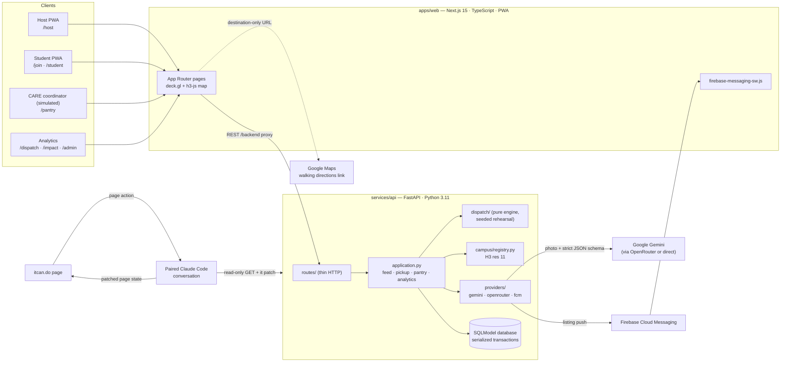

# Owl Plate — Good food. Shared.

**AI-assisted campus food redistribution for Kennesaw State University's Marietta campus.**

When an event ends with leftovers, the host takes one photo. AI vision estimates the food, servings and likely allergens. The host reviews and publishes, and opted-in students nearby discover the food, hold a serving for 10 minutes and walk over. Owl Plate is built for the KSU AI Club Hackathon 2026.

## Why it matters

The U.S. Government Accountability Office estimated that about **3.8 million U.S. college students experienced food insecurity in 2020** ([GAO-24-107074, 2024](https://www.gao.gov/products/gao-24-107074)). At KSU, CARE Services supports students facing food insecurity and runs a pantry on the Marietta campus (sources in [docs/DOMAIN.md](docs/DOMAIN.md)). Meanwhile, event leftovers are often thrown away, or posted in a group chat where the fastest few take everything.

Owl Plate keeps the host's effort to one photo and a quick review. Students get dignified, low-friction access with no forms and no proof of need. See [docs/SOUL.md](docs/SOUL.md) for the product principles.

## Features

| Feature | What it does |
|---|---|
| **Vision serving estimates** | Gemini returns structured items, servings, a range, likely allergens and confidence. Output is clamped and checked against a strict schema. |
| **Host-reviewed allergens** | The host edits servings and allergens and confirms three safety checks before publishing. Every allergen display says *may contain, confirm with host*. |
| **Campus discovery and map** | Students join with a nickname and optional dietary preferences, with no GPS. They browse listings at 43 verified Marietta buildings, as a list or on an H3/deck.gl campus map. |
| **Listing notifications (FCM)** | Opted-in students receive a Firebase web push naming the reviewed food, the servings and the pickup place, and it opens that listing. Lock-screen text never carries student, diet or allergen details. |
| **10-minute holds** | Each reservation holds one serving for 10 minutes. Releases, expiries and pickups update inventory inside one serialized transaction. |
| **Google walking directions** | A link to Google Maps walking directions to the pickup building. It sends only the destination coordinates, never the student's location. |
| **AI pickup assist** | The student photographs the food at pickup, and the model compares it with the published listing. A *consistent* result lets the student confirm. *Uncertain* and *inconsistent* results go to the host for explicit approval. |
| **Host inventory** | The host sees live counts (available, held, picked up, pantry) for their listings, plus a queue of pickup reviews. Hosts never see student identities. |
| **Proposed CARE Pantry handoff (simulated)** | Leftover servings can be referred to a *simulated* KSU CARE Pantry coordinator who accepts them, and the host confirms the handoff. Nothing is sent to KSU. |
| **Food rescue analytics** | `/dispatch` and `/impact` show published, picked-up and pantry servings, recovery rates, daily trends, categories and campus activity. |
| **It Campus Rescue Command Center** | An interactive [itcan.do](https://itcan.do) page with an isometric campus map, live inventory and an agent panel. Every action goes to a paired Claude Code conversation. |
| **Two-way Claude collaboration** | Taps on the It page reach a paired Claude Code session. That session reads Owl Plate (read-only) and writes its analysis back to the same page. See the [evidence status](#it-itcando-and-claude) below. |

A separate deterministic **seeded wave rehearsal** keeps the original dispatch engine: hard dietary filters, "just enough" wave sizing and widening H3 rings. Five synthetic personas exercise it from the internal `/admin` workspace.

## Architecture



The engine decides and the language model describes. Eligibility, inventory and dispatch are deterministic Python. Vision models only estimate what is in a photo. [docs/ARCHITECTURE.md](docs/ARCHITECTURE.md) has the full component, data and API description.

### Stack: implemented vs. planned

| Layer | Implemented and tested locally | Planned or not implemented |
|---|---|---|
| Web | Next.js 15 App Router, React 19, strict TypeScript, Tailwind, installable PWA manifest and icons | Production hosting (Vercel config only in `deploy/`) |
| API | FastAPI, Pydantic v2 schemas, OpenAPI-generated frontend types | Cloud API hosting |
| Database | SQLModel on SQLite. Mutations are serialized with `BEGIN IMMEDIATE`, and a PostgreSQL `SELECT … FOR UPDATE` path exists in code | No managed PostgreSQL provisioned |
| Vision | Gemini through OpenRouter (`google/gemini-3.8-flash` default), direct Gemini adapter, labeled offline fixture | Measured accuracy on a real labeled photo set |
| Pickup assist | OpenRouter Gemini comparison with the listing, plus a labeled fixture | — |
| Push | Firebase Cloud Messaging web push with Fernet-encrypted tokens. The default log mode simulates sends | Independently verified physical device receipt |
| Geography | Uber H3 resolution 11 over a verified 43-building Marietta registry, deck.gl maps, Google Maps walking links | Kennesaw campus |
| Sign-in | Synthetic demo auth and anonymous visitor sessions, behind two explicit demo gates | Microsoft Entra ID / KSU email sign-in |
| Photos | Sanitized, metadata-free JPEGs, kept until listing expiry (max 24 h, drafts 2 h). Pickup photos are never stored | S3 storage with lifecycle rules |
| Not built | — | Amazon Bedrock fallback, Twilio SMS, meal-swipe matching |

## Repository structure

| Path | Responsibility |
|---|---|
| `apps/web/app/` | Pages: `host`, `join`, `student`, `pantry`, `dispatch` (analytics), `impact`, `admin`, `survey` |
| `apps/web/components/`, `lib/` | Shared UI primitives, maps, API clients, generated types (`lib/api.generated.ts`) |
| `services/api/routes/` | Thin HTTP adapters, auth and error envelopes |
| `services/api/application.py` | Transactional orchestration: drops, holds, ticks, reset |
| `services/api/feed/`, `pickup/`, `pantry/`, `analytics/` | Domain rules that run inside the caller's serialized session |
| `services/api/dispatch/` | Pure, deterministic seeded-wave planner (no web, DB or network imports) |
| `services/api/vision/`, `providers/` | Vision contract and safety post-processing; Gemini, OpenRouter and FCM adapters |
| `services/api/campus/`, `data/campus/` | Verified Marietta building registry, research notes and validator |
| `services/api/db/`, `schemas/`, `storage/` | SQLModel tables and sessions, Pydantic contracts, short-lived photo storage |
| `prototypes/itcan/` | It pickup display, Campus Rescue Command Center and their helper scripts |
| `data/seed/`, `data/eval/` | Synthetic server seed; offline vision scoring fixtures and the opt-in live runner |
| `scripts/` | Launcher, demo reset, OpenAPI export, browser verification harnesses |
| `docs/` | Product, architecture, contracts, privacy and milestone handoffs |

## Getting started

### Prerequisites

- Python 3.11 and [`uv`](https://docs.astral.sh/uv/)
- Node.js 20.9 or newer (integration used Node 24)
- GNU Make

### Install and configure

```bash
cp .env.example .env        # private, gitignored; defaults are fully offline
make setup                  # .venv via uv, Python deps, npm ci
```

`.env.example` documents every variable. The defaults select demo auth, fixture vision and simulated (log) notifications. Never commit `.env` or `.secrets/`.

### Run: offline mode (no credentials)

```bash
make present        # production build, API :8017, web :3017, resets to the campus feed
```

Open `http://localhost:3017`, the host flow at `/host` and students at `/join`. Fixture vision returns a clearly labeled saved estimate. Pickup checks return a labeled fixture result, and notifications are logged, not sent. For hot-reload development, use `make demo` (reset) and then `make dev`.

### Run: live mode (private credentials)

| Command | Vision | Required in `.env` |
|---|---|---|
| `make present-openrouter` | Gemini via OpenRouter (vision and pickup assist) | `OPENROUTER_API_KEY` (optional `OPENROUTER_VISION_MODEL`) |
| `make present-live` | Direct Gemini API | `GEMINI_API_KEY` (optional `GEMINI_MODEL`) |
| `python -m scripts.present --vision openrouter --notifications fcm` | Gemini via OpenRouter, plus real push | Firebase service-account JSON in `.secrets/firebase-service-account.json`, `NEXT_PUBLIC_FIREBASE_CONFIG`, `NEXT_PUBLIC_FIREBASE_VAPID_KEY` |

Real web push needs HTTPS (or `localhost`). On iPhone it also needs **Add to Home Screen** (iOS 16.4 or later). For a phone build behind a proxy, set `NEXT_PUBLIC_API_URL=/backend` and `OWL_API_ORIGIN`. `make demo-reset` resets a running demo. Live provider errors are shown as errors and never fall back to fixture results.

## Verification

```bash
make test                       # pytest API suite, eval, campus and It unit tests, web node tests
make lint                       # Ruff check/format, ESLint, Prettier
make eval                       # offline synthetic scoring checks (not model accuracy)
make campus                     # validate the verified Marietta building registry
python3 -m unittest discover -s prototypes/itcan/tests -p 'test_*.py'   # It helpers and pages
cd apps/web && npm run typecheck && npm run build                        # types and production build
make types && git diff --exit-code apps/web/openapi.json apps/web/lib/api.generated.ts  # schema drift
```

`make smoke` runs an isolated HTTP pass over the seeded rehearsal. The browser harnesses in `scripts/verify_*.cjs` expect an isolated runtime on ports 3027/8027 (see [docs/FINAL_UI_HANDOFF.md](docs/FINAL_UI_HANDOFF.md)). They reset only that runtime. The final recorded results for the submitted commit are in [docs/SUBMISSION_VERIFICATION.md](docs/SUBMISSION_VERIFICATION.md).

## It (itcan.do) and Claude

Owl Plate publishes two pages on [It](https://itcan.do). Each is driven by a Claude Code conversation through the `it-bridge@it` plugin.

- **Pickup display** (`owl-whats-left-{listing id}`): one listing's counts and a **What's left?** button.
- **Campus Rescue Command Center** (`owl-rescue-command-center`): an isometric campus map, live inventory, rescue metrics and an agent panel whose text is written only by the paired Claude conversation.

**Install and pair** (presenter's Mac; read the installer before running it):

```bash
curl -fsSL https://itcan.do/install.sh -o ~/Downloads/it-install.sh && less ~/Downloads/it-install.sh
IT_INSTALL_PLAIN=1 IT_INSTALL_NO_PATH=1 sh ~/Downloads/it-install.sh
~/.it/bin/it setup --only claude-code      # enables it-bridge@it (Claude Code ≥ 2.1.287)
~/.it/bin/it network off && ~/.it/bin/it site --no-open   # pair one browser; never share the code
```

**Publish** (inside the Claude Code conversation that will answer actions, with Owl Plate reachable at the base URL):

```bash
python3 prototypes/itcan/create_command_center.py --base http://localhost:3017 --open
python3 prototypes/itcan/create_companion.py      --base http://localhost:3017 --open
```

Each script prints the page URL and one exact handler command per action. The command-center actions are `refresh_campus_activity`, `select_building`, `inspect_listing`, `whats_left`, `analyze_remaining_food`, `show_recommendations` and `dismiss_recommendations`. For analysis and recommendations, Claude runs `--brief`, reads the facts, then writes its own words back with `--respond` or `--recommend`. All handlers are read-only against Owl Plate, use only synthetic demo bearers and never request student data. To show the button on the host screen, set `NEXT_PUBLIC_IT_COMPANION_BASE_URL` to the It site origin. The full setup, contract and troubleshooting are in [prototypes/itcan/README.md](prototypes/itcan/README.md) and [STATE_CONTRACT.md](prototypes/itcan/STATE_CONTRACT.md).

**Evidence status.**
- **Pickup display:** the presenter reported a real paired run with It 0.1.45. Three taps arrived in Claude Code, and the page updated from live data (3 → 2 available, then 1 collected). This report could not be cross-checked against the database afterwards ([docs/IT_HANDOFF.md](docs/IT_HANDOFF.md)).
- **Command center:** it is covered by stand-in tests (a stub server and a fake `it` binary). No paired command-center session is recorded in this repository.

## Code tour (for Nudox reviewers)

| Area | Start here |
|---|---|
| Reservation and inventory | `services/api/feed/service.py`, `application.py` (`reserve`, `tick`), `db/session.py` (serialized transaction), `services/api/tests/feed/` |
| Contracts | `docs/API_CONTRACT.md`, `services/api/schemas/`, `vision/contract.py`, `pickup/contract.py`, generated `apps/web/lib/api.generated.ts`, `prototypes/itcan/STATE_CONTRACT.md` |
| Gemini provider | `services/api/providers/openrouter.py` (shared strict-schema boundary), `providers/gemini.py`, `vision/service.py` (`SafeVision`, fail-closed selection), `pickup/verifiers.py` |
| FCM | `services/api/providers/fcm.py` (encrypted token vault), `notifications.py`, `notification_content.py` (lock-screen-safe text), `apps/web/lib/fcm.ts`, `public/firebase-messaging-sw.js` |
| H3 | `services/api/campus/registry.py`, `sessions/areas.py`, `dispatch/planner.py`, `apps/web/lib/campus-map.ts`, `components/CampusMapCanvas.tsx` |
| It | `prototypes/itcan/campus_center.py`, `whats_left.py`, `command-center.html`, `prototypes/itcan/tests/` |
| Shared UI | `apps/web/components/ui/` (cards, dialogs, badges, animated numbers), `lib/motion.ts`, `lib/theme.tsx` |

## Limitations

- **AI estimates need human review.** Servings and allergens are estimates. The host reviews them before publishing, and they are shown as *may contain, confirm with host*. Religious diet tags come only from the host. The offline eval measures scoring logic, not live model accuracy.
- **Photos cannot prove pickup.** Pickup assist only checks that a photo looks consistent with the listing. It cannot establish physical pickup, quantity or food safety, so uncertain results go to the host.
- **The CARE Pantry handoff is a simulation.** No request reaches KSU CARE. KSU catering policy prohibits removing leftovers from event spaces, so real redistribution needs CARE and university approval.
- **No production deployment.** Everything runs locally with demo authentication. Physical push receipt is not independently verified, and KSU sign-in, managed hosting and storage are not done. The API Dockerfile in `deploy/` does not yet copy `data/campus/`.

## Future work

- Partner with KSU CARE Services, Dining and event offices on an approved food-handling policy. Then the pantry handoff could become a real referral.
- Add KSU sign-in through Microsoft Entra ID, managed PostgreSQL, and hosting with photo lifecycle storage.
- Extend the verified registry to the Kennesaw campus and to other universities, with meal-swipe sharing as a second supply source.
- Measure vision and pickup-assist accuracy on a consented, hand-labeled photo set before relying on them more heavily.

## Documentation

[AGENTS.md](AGENTS.md) (contributor rules) · [SOUL](docs/SOUL.md) · [Architecture](docs/ARCHITECTURE.md) · [API contract](docs/API_CONTRACT.md) · [Privacy and safety](docs/PRIVACY_SAFETY.md) · [Dispatch](docs/DISPATCH.md) · [Domain facts](docs/DOMAIN.md) · [Runbook](docs/RUNBOOK.md) · [Data and eval](docs/DATA.md). The milestone handoffs in `docs/*_HANDOFF.md` record the verification evidence for each milestone.
