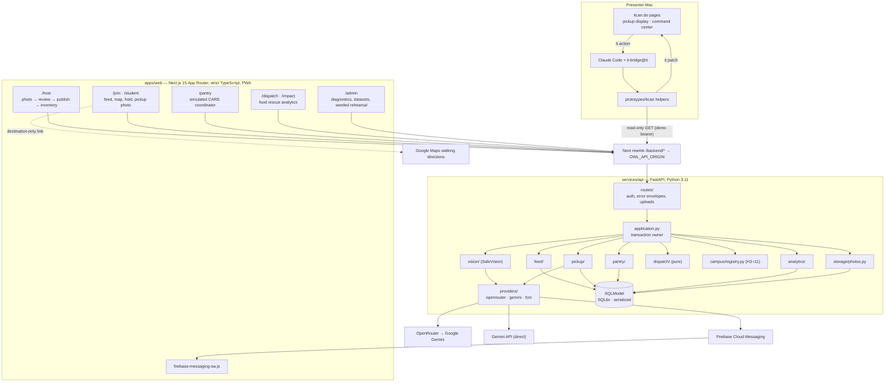

# ARCHITECTURE.md

How Owl Plate fits together as implemented. Update this file whenever the shape of the system changes. Frozen behavior lives in the contracts listed below. This file describes structure and boundaries, and it separates what is **implemented** from what is **planned**.

## System overview

Two scenarios share one codebase:

- **Campus feed** (`visitors`, the default) is the product experience. Students join with a nickname and optional dietary preferences, with no area, presence or GPS. `GET /students/me/feed` lists every unexpired published listing, including incompatible ones shown as disabled. `POST /drops/{id}/reserve` needs no invitation. Hosts choose a verified pickup building. See `CAMPUS_FEED_CONTRACT.md` and `CONSUMER_UX_CONTRACT.md`.
- **Seeded waves** (`seeded`) is the deterministic rehearsal of the original dispatch engine. Five synthetic personas (A–E), hard dietary filters, "just enough" wave sizing, widening H3 rings and invite deep links. It is reached from `/admin`. See `DISPATCH.md` and `API_CONTRACT.md`.

A drop snapshots `distribution_mode` at publication. Legacy drops without a stored mode default to seeded waves. `POST /demo/reset` clears sessions, drops, holds, outbox and push registrations in one transaction, and it preserves survey rows.

## Layering rules

| Layer | Owns | Must not |
|---|---|---|
| `routes/` | HTTP parsing, auth actor, error envelopes, multipart upload limits | Contain business rules |
| `application.py` | Opening the serialized transaction and composing domain services | Talk to providers while holding the write lock |
| `feed/`, `pickup/`, `pantry/`, `analytics/` | Domain rules executed inside a caller-owned serialized session | Open their own transactions |
| `dispatch/` | Pure eligibility, ranking and wave planning on plain dataclasses | Import web, database or network code |
| `vision/`, `providers/` | Provider contracts, strict JSON schemas, fail-closed selection, safety post-processing | Decide who receives food |
| `schemas/` | Pydantic v2 request and response models | — |

The web consumes `apps/web/lib/api.generated.ts`, which `make types` generates from the composed OpenAPI schema (`apps/web/openapi.json`). UI code aliases those generated definitions instead of hand-writing response types.

## Components

### Transactions and inventory

`db/session.py` serializes every mutation. On SQLite it uses `BEGIN IMMEDIATE`. On PostgreSQL it uses `SELECT … FOR UPDATE` on a singleton coordinator row; this path is coded but no managed database is provisioned. Inside that boundary:

- A reservation holds one serving for **10 minutes** (`HOLD_DURATION`), capped at the listing's expiry. Each student has one active hold across all listings.
- Release, hold expiry, pickup, host review approval, pantry referral and the scheduler tick update the same counts atomically. Per listing: `total = available + held + picked_up + pantry_held + pantry_transferred`.
- Provider calls (vision, pickup assessment) run **outside** the write transaction. The state is rechecked afterwards.

### Vision (`services/api/vision/`, `providers/`)

- Input: one JPEG/PNG (validated, resized, metadata stripped) plus an optional host note.
- Providers: `openrouter` (Gemini through OpenRouter, default model `google/gemini-3.8-flash`), `gemini` (direct API) and `fixture` (a clearly labeled saved estimate). The fixture requires both demo gates. A misconfigured live mode fails at startup, and a live error never falls back to a fixture result.
- Output schema: `items[{name, portion_unit, count_estimate}]`, `servings_estimate/low/high`, `allergens_likely`, `diet_tags`, `confidence`, `notes`. `SafeVision` clamps servings, maps allergens to the fixed enum (dairy, egg, gluten, peanut, tree_nut, soy, fish, shellfish, sesame) and drops unknown values. Vision may tag only vegetarian or vegan. Halal, kosher and pork-free come only from the host.
- The host always reviews the estimate, adjusts servings and allergens, and confirms the safety checks before publishing.

### Pickup assist (`services/api/pickup/`)

The student uploads a food-only photo for their own active hold. The model compares it with the immutable host-reviewed listing text and returns `consistent | uncertain | inconsistent` with a confidence score and a short explanation. A consistent result below 0.8 confidence becomes uncertain. Only a consistent latest attempt lets the student confirm. Otherwise the student can ask the host to review, and the host's explicit approval is recorded as a human override. Photos are processed in memory and never stored. Every surface shows: *A photo cannot independently establish physical pickup or food safety.* Contract: `PICKUP_CONFIRMATION_CONTRACT.md`.

### Simulated CARE Pantry (`services/api/pantry/`)

Leftover servings can be referred to a demonstration destination, KSU CARE Pantry at the Joe Mack Wilson Student Center. A synthetic coordinator on `/pantry` accepts or declines the referral, and the host explicitly confirms a **simulated** handoff. No message is sent to KSU. Notices state that KSU catering policy prohibits removing leftovers from event spaces. Contract: `PANTRY_FALLBACK_CONTRACT.md`.

### Analytics (`services/api/analytics/`)

`GET /analytics/operations` computes headline metrics, a daily series, categories, campus activity and recent events, after the normal expiry sweep. Student pickups and simulated pantry transfers are kept separate. Estimated-impact figures use explicit illustrative assumptions. `/admin` can load a clearly labeled, explicitly confirmed recording dataset. Contract: `OPERATIONS_CONTRACT.md`.

### Notifications (`providers/fcm.py`, `notifications.py`, `notification_content.py`)

- `NOTIFICATION_PROVIDER=log` (the default) records simulated sends, and push-token registration returns 503.
- `NOTIFICATION_PROVIDER=fcm` stores device tokens encrypted with Fernet (`PUSH_TOKEN_ENCRYPTION_KEY`). It decrypts them only inside the transport and sends Firebase web push to visitor sessions and to explicitly allowlisted synthetic students.
- When a listing is published, each eligible opted-in student gets one durable announcement. Feed reads, late joins, reservations and ticks do not send more. The lock-screen text names the reviewed food, the servings and the pickup place, and it never carries student, diet, allergen or priority data. Tapping it opens `/student?drop=<id>`. Hosts can register for pickup-review alerts.
- iPhone web push requires Add to Home Screen (iOS 16.4+).

### Geography (`services/api/campus/`, `data/campus/`)

`data/campus/marietta.json` holds the researched Marietta building registry. Only records marked verified (43) reach `GET /buildings`, host building selection and H3 resolution-11 matching. Provenance and positional limits are in `data/campus/RESEARCH.md`, and `make campus` validates the dataset. The seeded scenario computes rings with `h3.grid_disk`. The web renders maps with deck.gl and `h3-js`. Walking directions are a plain Google Maps URL that carries only the pickup destination, with no origin and no API key.

### Photos (`services/api/storage/photos.py`)

Only the sanitized, metadata-free JPEG re-encoded from the host upload is kept. Drafts are kept for at most 2 hours. Published photos are kept until listing expiry, never more than 24 hours. The store purges expired photos before every read. The photo is served only to authorized roles through `GET /drops/{id}/photo` with a Bearer header. Pickup photos and recording datasets contain no stored images.

### Auth

Synthetic demo roles (`demo-host`, `demo-projector`, pantry coordinator, seeded students) and anonymous visitor sessions (`POST /sessions`). They are composed only when **both** `AUTH_MODE=demo` and `DEMO_MODE=true` are set. CARE-priority data is never returned to non-admin callers (see `PRIVACY_SAFETY.md`).

### It (itcan.do) integration (`prototypes/itcan/`)

These are standard-library Python helpers and static HTML pages for It's documented page API (`It.onState`, `data-it-bind`, `data-it-show`, `It.action`).

- **Pickup display** `owl-whats-left-{drop_id}`: a per-listing counts page with **What's left?**.
- **Campus Rescue Command Center** `owl-rescue-command-center`: verified buildings with live inventory, rescue metrics, listing inspection and an agent panel.

Page actions arrive in the paired Claude Code conversation. That conversation runs the printed handler, which reads Owl Plate with read-only GET requests and runs `it patch` on the same page. For analysis and recommendations, Claude reads a factual `--brief` and writes its own text back. Pages never receive credentials, student identities, photos or per-student status. The state contract is `prototypes/itcan/STATE_CONTRACT.md`.

## Data model (SQLModel)

| Table | Purpose |
|---|---|
| `Drop` | Listing: host, status, distribution mode, snapshotted building/room, reviewed vision estimate, counts (JSON `data`) |
| `DropPhoto` | Short-lived sanitized listing photo |
| `VisitorSession` | Anonymous campus-feed student: nickname, dietary preferences, alert opt-in |
| `Claim` | 10-minute hold and its outcome (held, picked up, released, expired) |
| `PickupAttempt` | Structured pickup assessment and host-review state (no image) |
| `FeedNotification` | Durable one-per-student listing announcement outbox |
| `HostPickupNotification` | Host review alert outbox |
| `PantryReferral` | Simulated CARE request, decision and handoff |
| `PushRegistration`, `HostPushRegistration` | Encrypted FCM tokens |
| `Student`, `Wave`, `Invite` | Seeded-wave personas, waves and invitations |
| `Coordinator`, `DemoSettings`, `DatasetMarker` | Serialization row and demo clock, scenario, recording-dataset provenance |
| `SurveyResponse` | Anonymous optional survey answers; collection is off by default |

## API surface

The full schema is served at `/docs` and checked in as `apps/web/openapi.json`.

| Area | Endpoints |
|---|---|
| Sessions and students | `POST /sessions`, `GET/DELETE /sessions/me`, `PUT /students/me/preferences`, `GET /students/me/feed`, `GET /students/me/reservations`, `POST /students/me/push-token` |
| Hosts and listings | `POST /drops` (photo → estimate), `PATCH /drops/{id}`, `POST /drops/{id}/publish`, `GET /drops/{id}`, `GET /drops/{id}/photo`, `GET /hosts/me/drops`, `POST /hosts/me/push-token`, `GET /buildings` |
| Reservations and pickup | `POST /drops/{id}/reserve`, `POST /claims/{id}/release`, `POST /claims/{id}/pickup-photo`, `GET /claims/{id}/pickup-verification`, `POST /claims/{id}/pickup-review`, `POST /claims/{id}/pickup`, `GET/POST /drops/{id}/pickup-reviews…` |
| Pantry (simulated) | `GET/POST /drops/{id}/pantry-referral`, `POST /drops/{id}/pantry-referral/handoff`, `GET /pantry/referrals`, `POST /pantry/referrals/{id}/decision` |
| Analytics | `GET /analytics/operations`, `GET /distribution` |
| Seeded rehearsal | `GET /students/me/invites`, `POST /invites/{id}/claim`, `POST /invites/{id}/decline`, `POST /students/me/presence`, `GET /drops/{id}/dispatch` |
| Demo (gated) | `POST /demo/reset`, `POST /demo/tick`, `GET /demo/status`, `GET /demo/active-drop`, `GET /demo/areas`, `POST /demo/recording-dataset` |

Screens poll the API; there are no websockets.

## Sponsor technology map

| Company | Technology | Real job | Status |
|---|---|---|---|
| Google | Gemini (via OpenRouter or direct) | Food items, servings, allergens; pickup photo comparison | Implemented; live accuracy not measured |
| Google | Firebase Cloud Messaging | Listing alerts and host review alerts | Implemented; physical device receipt not independently verified |
| Google | Maps | Walking directions to the pickup building | Implemented (URL link) |
| Uber | H3 | Building cells and seeded-wave rings | Implemented |
| Uber | deck.gl | Campus and analytics maps | Implemented |
| It (itcan.do) | Paired pages + Claude Code | Pickup display and command center driven by Claude | Implemented; see evidence in `IT_HANDOFF.md` |
| Microsoft | Entra ID | KSU-only sign-in | **Planned** — demo auth only |
| Amazon | AWS, S3, Bedrock | Hosting, photo lifecycle, fallback vision | **Not implemented** |
| Twilio | SMS | Text fallback | **Not implemented** |

## Configuration

`.env.example` is the source of truth for variables and their safe defaults (demo auth, fixture vision, log notifications, survey off). Secrets stay in the gitignored `.env` and `.secrets/`. The launcher `scripts/present.py` (`make present`, `present-openrouter`, `present-live`) builds and starts both processes, selects the vision and notification modes explicitly, and prints which mode is active.

## Deployment candidate (not deployed)

`deploy/` contains a reviewed Vercel configuration and an API Dockerfile. The phone/HTTPS topology uses `NEXT_PUBLIC_API_URL=/backend` with the server-side `OWL_API_ORIGIN` rewrite. No hosting account, domain, managed database or storage has been provisioned. Known debt: `deploy/api.Dockerfile` copies `data/seed` but not `data/campus/`, so the image would lack the verified building registry. This must be fixed before any deployment. A production deployment would also need KSU sign-in, a durable PostgreSQL URL and photo storage with 24-hour lifecycle rules.

## Superseded design notes

Earlier drafts of this file described a broadcast-free wave dispatcher as the main experience, AWS hosting with S3 and Bedrock, Entra sign-in, Twilio SMS and meal-swipe tables. The campus feed replaced wave dispatch for normal use, and the seeded scenario preserves the engine. The cloud, SMS, Entra and meal-swipe items were not built and appear above only as planned. Milestone handoffs (`docs/*_HANDOFF.md`) keep the historical verification record.
